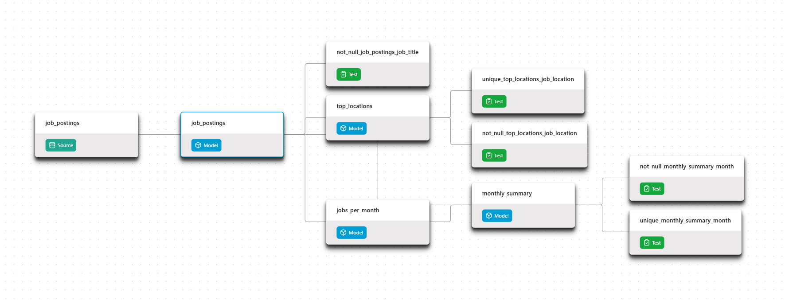

# Automated Job Postings Pipeline (V1)

[](https://github.com/hoangkhon28/dbt-duckdb-pipeline/actions/workflows/dbt_build.yml)


An automated **dbt + DuckDB** pipeline that transforms a year of raw job-posting data (Parquet) into tested, documented analytics tables. GitHub Actions rebuilds the warehouse on a schedule and publishes the DuckDB database to GitHub Releases, so anyone can query it with a single command.

> **Why "V1"?** This version is DuckDB-only and orchestrated by GitHub Actions. V2 is a production-grade pipeline on Databricks (staging / intermediate / marts layers, star schema, snapshots, incremental loads).

## Table of contents

- [Highlights](#highlights)
- [Architecture](#architecture)
- [Automation](#automation)
- [Query the warehouse](#query-the-warehouse)
- [Documentation](#documentation)
- [Getting started](#getting-started)
- [Project structure](#project-structure)
- [Data source](#data-source)

## Highlights

| Capability | Location |
|---|---|
| dbt models, sources and `ref()` dependencies | [`analytics/models/`](analytics/models) |
| Data tests (`not_null`, `unique`) | [`analytics/models/schema.yml`](analytics/models/schema.yml) |
| Documentation persisted into the database | [`analytics/models/schema.yml`](analytics/models/schema.yml) |
| Scheduled CI/CD | [`.github/workflows/dbt_build.yml`](.github/workflows/dbt_build.yml) |
| Secret-free CI profile | [`ci/profiles.yml`](ci/profiles.yml) |
| Public, queryable warehouse | [GitHub Releases](https://github.com/hoangkhon28/dbt-duckdb-pipeline/releases/tag/warehouse) |
| Hosted dbt docs and lineage graph | [Documentation](#documentation) |

## Architecture

Monthly Parquet files (July 2025 – June 2026) are read directly by DuckDB, cleaned in a single base view, and aggregated into three analytics tables.

```
raw Parquet (source: raw.job_postings)
        │
        ▼
  job_postings (view)
     │          │            │
     ▼          ▼            ▼
jobs_per_month  top_locations  monthly_summary
     └──────────────────────────────▲
        (monthly_summary also depends on jobs_per_month)
```

| Model | Materialization | Description |
|---|---|---|
| `job_postings` | view | Cleaned postings with scrape errors removed |
| `jobs_per_month` | table | Postings per month and role |
| `top_locations` | table | Top 10 job locations |
| `monthly_summary` | table | Share of remote postings per month |



### dbt features used

- **Declared sources**: raw Parquet files documented in `sources.yml` and referenced via `source()`
- **Model dependencies**: `ref()` guarantees build order across threads
- **Materializations**: a view for the base model, tables for analytics outputs
- **Data tests**: `not_null` and `unique`, executed by `dbt build`
- **Environments**: `dev` (1 thread) and `prod` (4 threads) targets
- **Persisted docs**: model descriptions written into database metadata (`persist_docs`)

## Automation

The [GitHub Actions workflow](.github/workflows/dbt_build.yml) runs on:

| Trigger | When |
|---|---|
| Push | Every push to `master` |
| Schedule | Weekly, on Mondays |
| Manual | `workflow_dispatch` |

Each run checks out the repository, installs `uv` and dependencies, downloads the raw data, runs `dbt build` against the `prod` target, and uploads `prod.duckdb` to the `warehouse` GitHub Release.

## Query the warehouse

The only requirement is [DuckDB](https://duckdb.org/docs/installation). Start `duckdb` and run:

```sql
INSTALL httpfs;
LOAD httpfs;

ATTACH 'https://github.com/hoangkhon28/dbt-duckdb-pipeline/releases/download/warehouse/prod.duckdb' AS jobs;
USE jobs;

SHOW TABLES;
SELECT * FROM monthly_summary;
```

## Documentation

dbt-generated documentation, including the full lineage graph, is published via GitHub Pages:

- **Live docs:** _add your GitHub Pages URL here_

## Getting started

**Prerequisites:** Git, [uv](https://docs.astral.sh/uv/), and [DuckDB](https://duckdb.org/docs/installation).

```bash
git clone https://github.com/hoangkhon28/dbt-duckdb-pipeline.git
cd dbt-duckdb-pipeline
uv sync

# Download raw Parquet files into data/raw/
uv run python scripts/download_data.py

# Build models and run tests
cd analytics
uv run dbt build --target prod --profiles-dir ../ci
```

Generate and serve the docs locally (from `analytics/`):

```bash
uv run dbt docs generate --profiles-dir ../ci
uv run dbt docs serve --profiles-dir ../ci
```

## Project structure

```
.
├── analytics/            # dbt project (models, tests, docs config)
├── ci/profiles.yml       # dbt profile used by GitHub Actions
├── scripts/              # data download script
├── .github/workflows/    # CI/CD pipeline
├── docs/                 # dbt docs published via GitHub Pages
└── images/               # README assets
```

## Data source

Job-posting data comes from [datanerd.tech](https://datanerd.tech), distributed through the course repository's Releases.
